# مُراجِع (Moraje): an AI agent that turns old handwritten Saudi deeds into reviewed digital records

**HUMAIN Future AI Builders Hackathon · Challenge 3: Autonomous Enterprise**

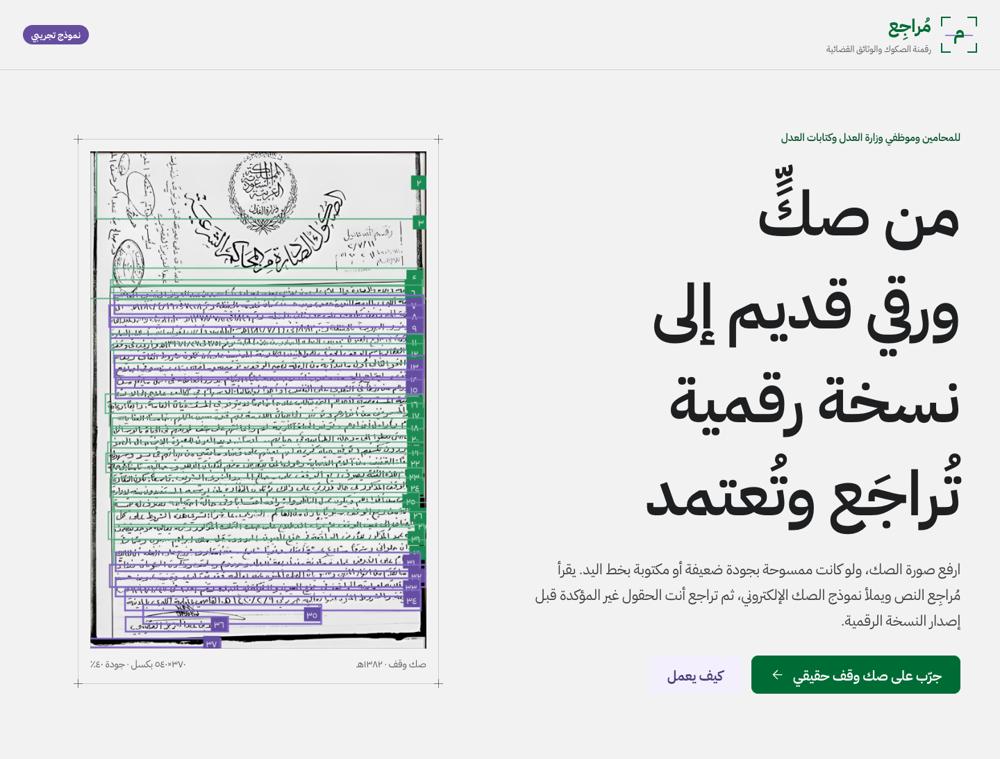

> Decision support only, not legal advice. The digital copy is not an official document and never replaces the original.

## The problem

My cousin works at the Ministry of Justice. Her job is to turn old court deeds (صكوك) into text, so the
ministry's system can create a digital copy and attach the deed's data to its owner's profile. The deeds are
decades old: handwritten, faded, stamped over, often photographed on a phone at a few hundred pixels. Most AI
models cannot read them, so the work is still done by hand. She reads and types **hundreds of these a day, and
thousands in some weeks**.

**مُراجِع owns that process end to end.** A clerk uploads a photo of the deed. The agent checks the image,
enhances it, finds every handwritten line, reads it, fills the Electronic Deed Template, and produces the
digital copy and searchable data. The human only looks at the fields the agent is unsure about, and approves.

## What the agent does

Six stages, each shown live on one page as it runs:

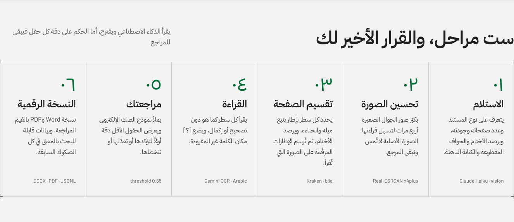

| # | Stage | How | AI used |
|---|---|---|---|
| 1 | **Intake** | Document type, scanned or digital, page count, quality score, visible problems (faded ink, stamps over text, cut edges) | Claude Haiku (vision), one call |
| 2 | **Image enhancement** | Pages smaller than 1600 px are upscaled 4x so the reader can see the ink. The original stays the record | Real-ESRGAN, local |
| 3 | **Page segmentation** | Every handwritten line found as an outline that follows its slope and curve; stamps found separately | Kraken `blla`, local |
| 4 | **Reading and field review** | The page goes to the reader with the numbered line outlines drawn on it; each line comes back with its box number. Claude maps the lines onto the deed template; low-accuracy fields go to the reviewer first | Gemini (free tier) + Claude Haiku (text only) |
| 5 | **Digital copy** | The Electronic Deed Template filled with the reviewed values, live; Word, PDF, print, and embedded data (JSONL) | None (template in code) |
| 6 | **Decision** | The reviewer approves or asks for a clearer copy. No deed is ever approved automatically | None |

The same agent also reviews ordinary Arabic contracts (the challenge's "AI Contract Review Agent" example):
clause typing, policy checks against `config/rules.json`, risk score and suggested rewording, then automatic
approval or escalation. See [Contract review](#contract-review).

### A walk through one deed

A real waqf deed (صك وقف) from المحكمة الكبرى بالمدينة المنورة, photographed at low resolution.

**1. Intake** checks what was uploaded:

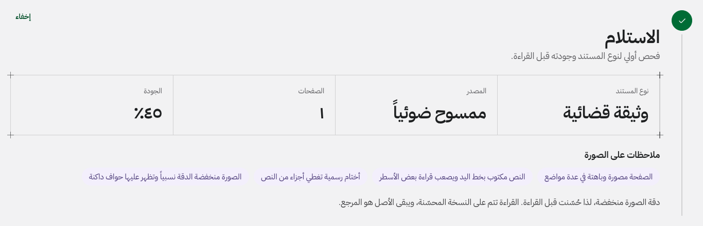

**2. Enhancement**: drag the slider to compare the original with what the reader sees:

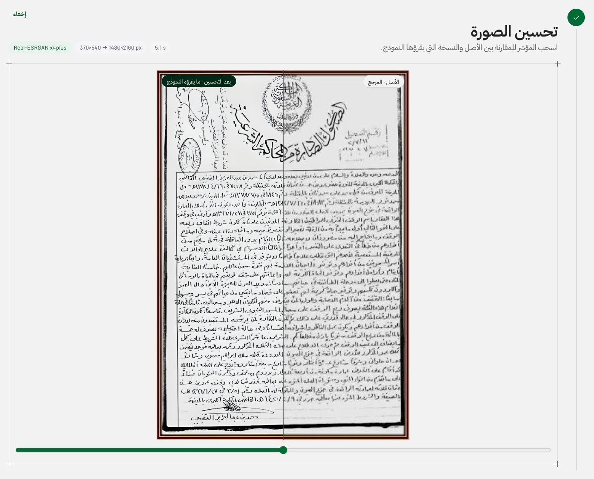

**3. Segmentation**: Kraken outlines all 50 lines, including the margin notes, following the slope of the writing:


The reader then gets this image: the enhanced page with thin numbered outlines, and the numbers in a white
strip on the right so they never cover ink:

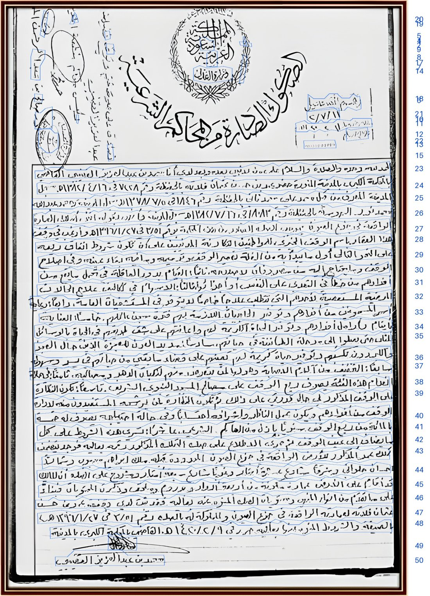

**4. Reading and review**: the lowest-accuracy fields come first. Each shows its accuracy, the line it came from
(click to highlight it on the page), and whether it is a literal quote of that line. The reviewer confirms,
edits, or skips:

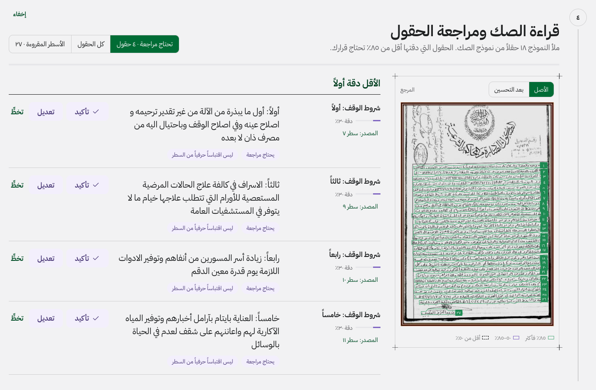

**5. Digital copy**: the deed template, filled and updated with every edit:

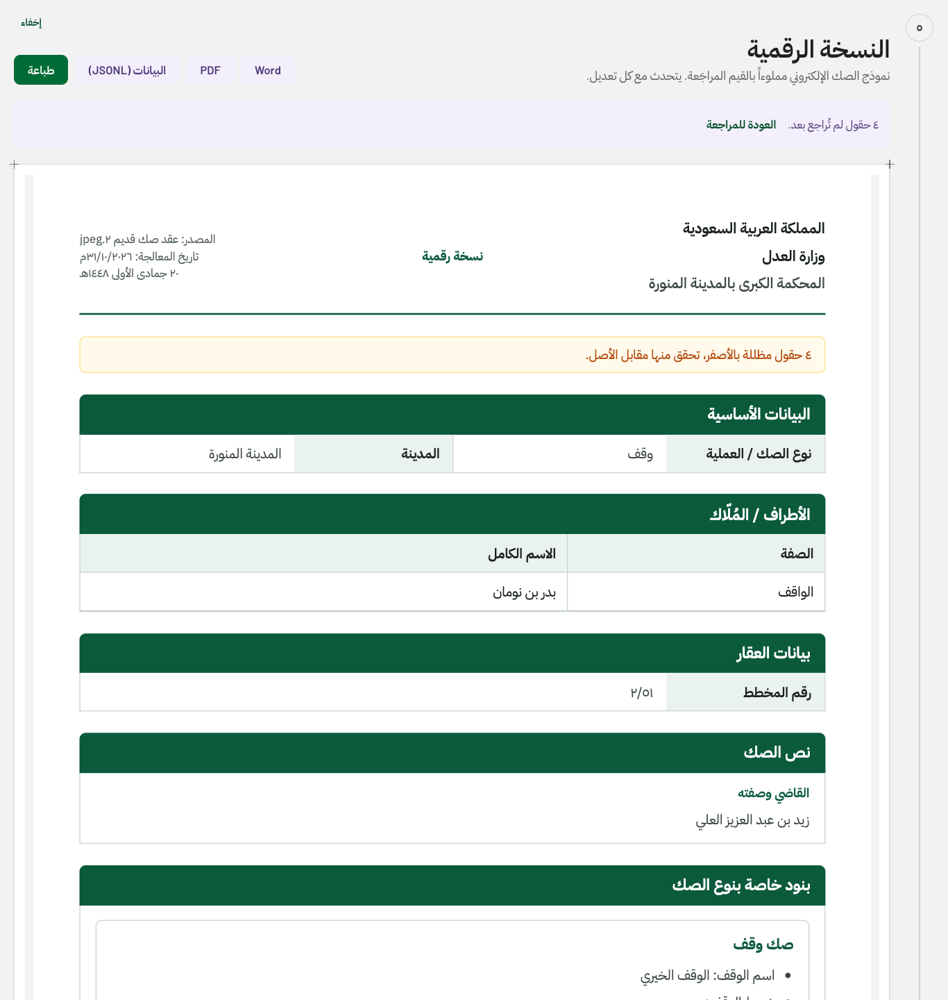

**6. Decision**: approve is locked until every low-accuracy field has been reviewed:

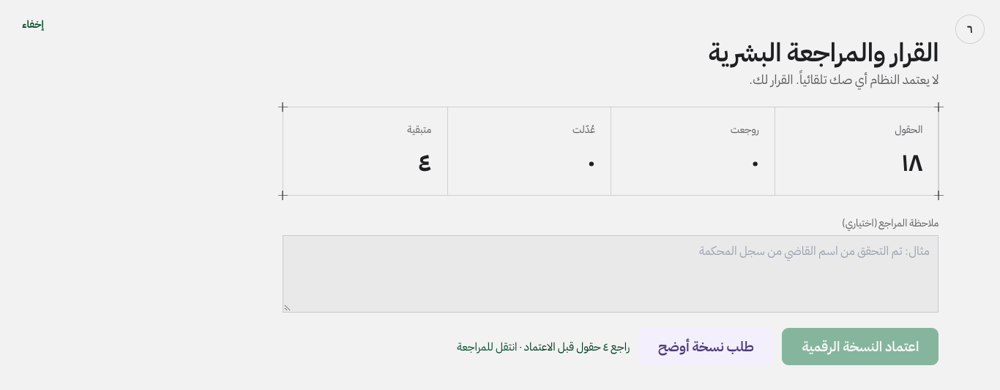

Approving opens a confirmation with the summary and the files to download:

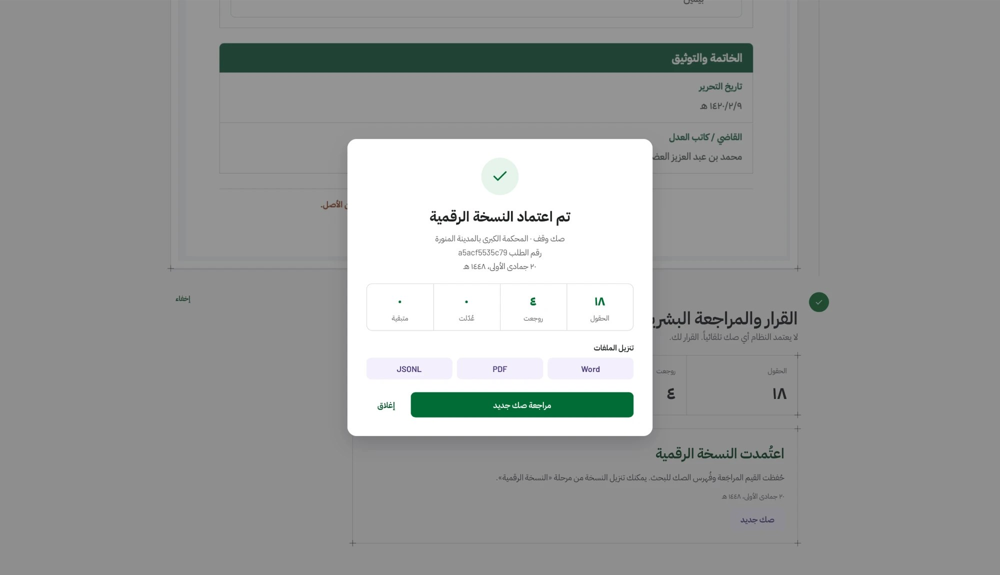

After closing it, the section shows the recorded decision:

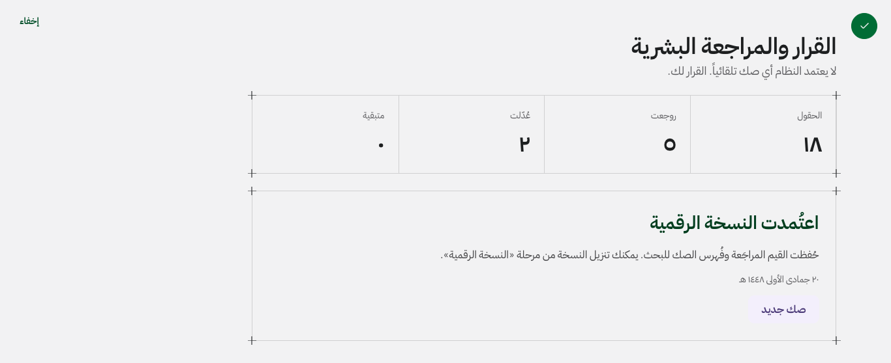

Upload, history of past requests, and semantic search over all reviewed deeds sit above the request.
"مراجعة صك جديد" starts a blank review, waiting for the next deed:

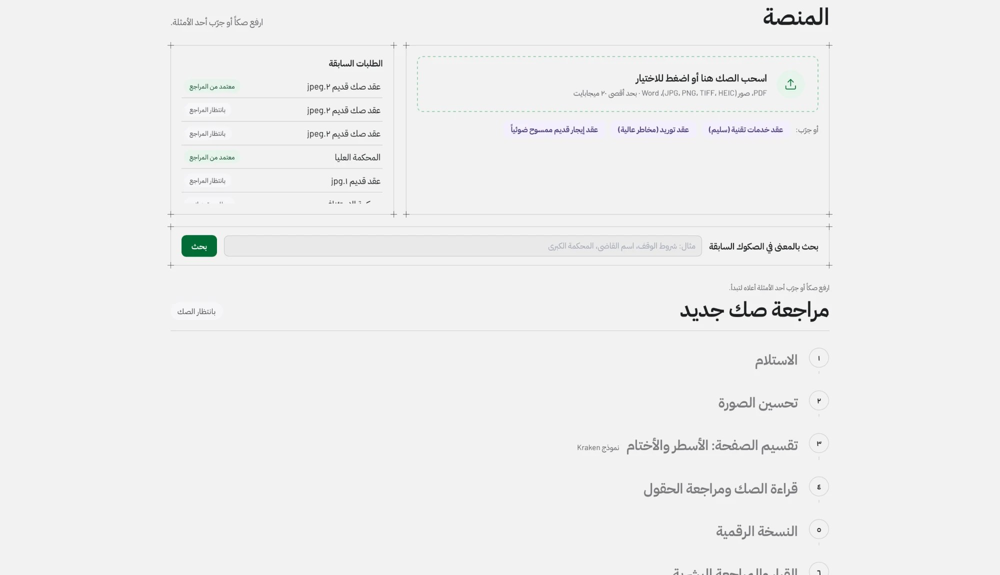

---

## Judging criteria

### 01 · Task performance

All numbers below come from the 38 deed and court-record requests recorded in `data/app.sqlite` during
development, on real old deeds. They were not tuned on these pages; each run is the pipeline as it was at the time.

**Field accuracy against reviewer-verified values.** One deed (عقد صك قديم ٢), four fields whose correct
value a reviewer verified. Scored on each model's *original* output, before any human edit:

| Reader + segmentation | Court | City | Judge's name | Waqf condition 2 |
|---|---|---|---|---|
| Gemini 3.8 Flash + classic boxes | ✓ | ✓ | ✗ | ✓ |
| Gemini 3.5 Flash-Lite + classic boxes | ✓ | ✓ | ✗ | ✗ |
| **Gemini 3.5 Flash-Lite + Kraken (default)** | ✓ | ✓ | close: 3 of 4 words | ✓ |
| Gemma 4 26B + Kraken (2 runs) | ✗ | ✓ / ✗ | ✗ (invented) | ✗ (invented) |

On the same deed and the same reader, adding Kraken fixed waqf condition 2 and got the judge's first names
right. This is one deed, so it is a signal, not a benchmark; see [Limitations](#limitations-and-next-steps).

**Speed and cost per deed** (completed runs, one page each):

| Reader | Runs | Median time, upload to review | Claude cost per deed | Reader cost |
|---|---|---|---|---|
| Gemini 3.5 Flash-Lite (default) | 5 | **40 s** | $0.0020 | free tier |
| Gemini 3.8 Flash | 4 | 138 s | $0.0017 | free tier |
| Gemma 4 26B | 4 | 124 s | $0.0021 | free |

Total Claude spend across all 38 deed requests: **$0.04**. The reviewer's time goes only to flagged fields:
on the default setup, 4 of 18 filled fields were flagged on the deed above.

**Pipeline completion.** 24 of 38 requests completed. All 14 that stopped did so on an outside service, and
each stopped cleanly with an Arabic message and no crash: Google's free tier overloaded (503/504, 8 runs),
the free daily limit (3), a model Google closed to new users (2), and one run interrupted by a server restart.

### 02 · Robustness and adaptation

The agent keeps working when inputs, services or models change:

- **Any file**: PDF, photos (JPEG, PNG, TIFF, HEIC from iPhones, WebP…), Word, text. Wrong or missing file extensions are detected from the content.
- **Bad images**: tilted pages, curved lines, faint ink, stamps over text, 370 px phone photos. Enhancement and Kraken were added for exactly these.
- **Fallbacks at every step**:
  - Kraken missing or failing → the classical line finder, flagged in red in the UI.
  - Enhancement failing → the original page is read.
  - Reader overloaded or rate-limited (429, 5xx, timeouts) → waits of 5, 15 and 30 s, then a clear message.
  - A model rejecting a setting (high resolution, thinking level, strict JSON) → retried without it.
  - Claude unavailable or over budget → rule-based fallbacks.
- **Model changes are one line**: `GEMINI_MODEL=...` in `.env`. During the hackathon the reader changed model several times as free quotas ran out and one model was closed to new users. Only Gemma, which takes different settings, needed code changes.
- **Never fails open**: an error anywhere escalates to a human; a deed is never approved automatically.
- **Against invented values**: a field must be an exact quote of the line it cites, or its confidence drops and it is flagged "ليس اقتباساً حرفياً من السطر". Unreadable words must be written `[؟]`, never guessed.

### 03 · Evaluation and iteration

**Each reader was measured on the same real deeds before keeping or dropping it:**

| Approach | Result on real deeds | Kept? |
|---|---|---|
| Historic-Arabic-OCR (Qwen2-VL LoRA), line by line | Fluent text unrelated to the page; mean confidence 0.29 | Removed |
| Arabic-English-handwritten-OCR-v3 | Weak reading; mean confidence 0.28 | Removed |
| Indra OCR | Excellent on print, nothing usable on handwriting; 0.32 | Removed |
| HATFormer (manuscript line model) | 0.22 | Removed |
| DocRes image restoration | About 11 minutes per page on an M3, no gain | Removed |
| Real-ESRGAN x4plus enhancement | Small phone photos become readable | **Kept** |
| Gemini, whole page, text only | Faithful reading; lines matched to boxes by order, so numbers drifted | Improved |
| Gemini with numbered outlines drawn on the page | Each line placed on its own box | **Kept** |
| Classical line boxes (image analysis) | Level boxes cross several lines on tilted writing | Fallback only |
| **Kraken baseline segmentation** | Tilted, curved outlines; better fields on the same deed (table above) | **Kept** |
| Gemma 4 26B as reader | **Invented** court, judge, deed number "١٢٣٤٥٦٧٨٩٠" and waqf conditions, while reporting 0.88 confidence | Rejected |

(Confidence numbers come from different models' own scoring, so they show each model's certainty, not
comparable accuracy. The field table above is the accuracy measure.)

The Gemma result is the most important finding: **a model's own confidence cannot be trusted on these
deeds**. That is why the agent keeps three checks the model does not control: values must quote their
lines, unreviewed fields block approval, and the reviewer sees the source line next to every value.

**Automated tests**: 85 tests (`make test`), all passing, in mock mode so they never call a paid API.
They cover:

- schemas and routing (approve, escalate on policy, on OCR, on error, on unreadable);
- the deed template, edits and rendering;
- the numbered-outline image and box placement;
- the Kraken worker protocol and fallback;
- Gemini retries and each setting fallback;
- Gemma handling, any-file rendering, enhancement, embeddings and spend limits.

Bugs found while testing on real deeds got regression tests, for example a Kraken crash that had silently
fallen back to the classical boxes; it is now shown in red in the UI and covered by a test.

### 04 · Technical judgment and creativity

- **AI only where it adds judgement.**
  - The digital copy, risk scoring and the approve or escalate decision are plain code.
  - Claude reads no images in the deed flow except one intake call; it only maps already-read lines onto template fields.
  - A model can never approve a deed.
- **Draw the segmentation on the image.** Reading line crops one by one means dozens of requests per page, too slow and too many for free tiers. Asking the model for coordinates made answers long and slow. Instead, the app draws numbered outlines on the page it sends and asks for the box number of each line: one request, exact placement, short answers.
- **The enhanced image is only for reading.** Super-resolution can invent detail, so the original stays the record: the page view, stamps and the copy all use it.
- **Kraken in its own environment.** It needs older PyTorch than the app, so it runs as one long-lived worker in `.venv-kraken` that loads the model once, rather than downgrading the app's libraries.
- **Human in the loop where it matters.** The reviewer does not retype the deed. They confirm or fix only the fields under 85% accuracy, and see the source line on the page for each.
- **Local and cheap.**
  - Enhancement, segmentation and the embeddings for semantic search all run on the machine.
  - Claude costs about $0.002 per deed; the reader runs on a free tier.
  - A hard budget (`CLAUDE_BUDGET_USD`) switches to rule-based fallbacks when reached.

### 05 · Engineering quality

```
upload ─▶ intake ─▶ digitize ─────────────────────────────▶ reconstruct ─┬─▶ deed (template) ──────────────┐
          Haiku     enhance (Real-ESRGAN)                    Word + PDF   │                                 ├─▶ decide ─▶ human_review ─▶ finalize
          vision    segment (Kraken, fallback classical)     (code)      └─▶ clause ─▶ policy ─▶ redline ───┘    code      LangGraph interrupt
                    read (Gemini, numbered outlines)
                    group lines (Haiku, text only)
any error or unreadable page ─────────────────────────────────────────────────────────────────────────────▶ decide (escalate)
```

- **Orchestration**: LangGraph with a SQLite checkpointer; the human review is a real graph `interrupt()` resumed from the page.
- **Backend**: FastAPI with progress streamed live over Server-Sent Events. Every agent output is validated against Pydantic models.
- **Frontend**: React + TypeScript, right-to-left, one page.
- **Configuration**: in `.env` and `backend/app/config.py`; nothing hard-coded in agents.
- **Reproducible**: `make install`, `make kraken`, `make models`, `make test`, `make build`.

| Path | What |
|---|---|
| `backend/app/graph.py` | Pipeline graph, routing, human review |
| `backend/app/agents/` | Intake, digitization, reconstruction, clause, policy, redline, decision |
| `backend/app/tools/kraken_seg.py`, `kraken_worker.py` | Kraken segmentation client and worker |
| `backend/app/tools/gemini_ocr.py` | Reader: outlined image, box numbers, retries, model quirks |
| `backend/app/tools/esrgan/` | Real-ESRGAN enhancement |
| `backend/app/deed.py` | Deed template fields, quote check, rendering |
| `backend/app/embeddings.py` | Local embeddings, search, JSONL export |
| `agent_skills/` | System prompts for each agent |
| `frontend/src/` | The page |
| `backend/tests/` | 85 tests |

### 06 · Communication

This README follows the judging criteria. For a two-minute demo:

1. Open the page and upload a deed photo, or pick a sample.
2. Watch the six stages fill in.
3. Drag the enhancement slider.
4. Show the tilted Kraken outlines.
5. In the review, click "المصدر: سطر …" to jump to the line, and fix one flagged field.
6. Show the digital copy updating.
7. Approve.

---

## Run it

```bash
make install            # app environment, frontend packages, and the Kraken environment
make models             # Real-ESRGAN weights (~72 MB) and the embedding model (~1.1 GB)
cp .env.example .env    # add GEMINI_API_KEY (free from Google AI Studio) and ANTHROPIC_API_KEY
make build              # build the page once
.venv/bin/uvicorn backend.app.main:app --port 8000
```

Open http://localhost:8000. `make test` runs the 85 tests.

Main settings in `.env` (all have defaults):

| Setting | Default | Meaning |
|---|---|---|
| `GEMINI_MODEL` | `gemini-3.5-flash-lite` | The reader. Also tested: `gemini-3.8-flash`, `gemini-2.5-pro`, `gemma-4-26b-a4b-it` (not recommended, see above) |
| `SEGMENTER` | `kraken` | Or `classic` |
| `ENHANCE_IMAGES` | `1` | Real-ESRGAN for small pages |
| `CLAUDE_BUDGET_USD` | `4.5` | Hard cap on Claude spend |
| `EMBEDDINGS_ENABLED` | `1` | Local semantic search and export |

**Privacy:** on Gemini's free tier, Google may use uploaded pages to improve its products. A ministry
deployment would use a paid Gemini tier or a self-hosted reader. Every other step already runs locally.

## Contract review

For ordinary contracts the agent runs the review branch instead of the deed template:

- **Clause typing**: Claude Haiku.
- **Policy check**: Claude Sonnet, against the rules in `config/rules.json`, with evidence that must be an exact quote.
- **Risk score**: computed in code from rule weights.
- **Suggested wording**: from approved templates in economy mode.
- **Decision**: in code, from the thresholds in `rules.json`. A contract is approved automatically only when risk is low and reading confidence is high. Otherwise it escalates to the same reviewer section.

The three synthetic samples in `samples/` exercise this branch: one compliant, one risky, one old scan.

## Limitations and next steps

- **Evaluation set**: field accuracy is measured on two deeds with four verified fields. The next step is a labelled set of 50 or more deeds, with every field typed by a ministry clerk, to report field-level accuracy and character error rate.
- **Self-reported confidence**: the reader's legibility flag decides which fields are flagged, and Gemma showed it can be confidently wrong. A second, independent check (for example a second reader on flagged pages) would make flagging more reliable.
- **Judges' names and signatures** are the hardest lines. All readers got them at most partly right.
- **Margin notes**: dense notes produce many small outlines, and their numbers crowd the strip on the right.


## Credits

[Kraken](https://kraken.re) (Apache 2.0), [Real-ESRGAN](https://github.com/xinntao/Real-ESRGAN) (BSD-3),
[multilingual-e5-base](https://huggingface.co/intfloat/multilingual-e5-base) (MIT), Google Gemini API,
Anthropic Claude, LangGraph, FastAPI, React.
